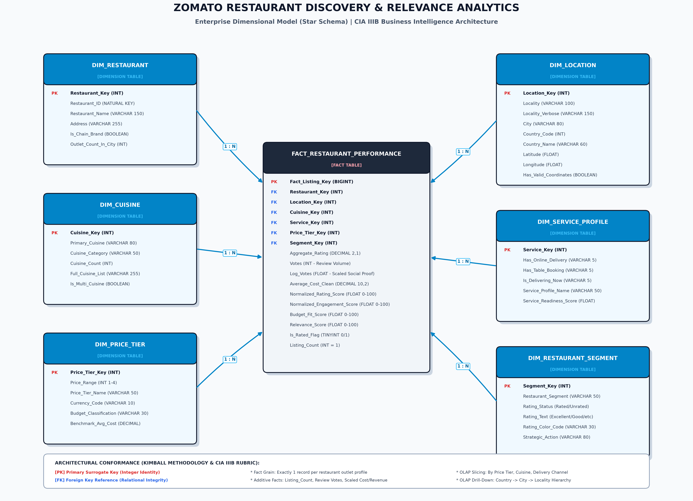

# Beyond the 5-Star Trap: A Multi-Criteria Restaurant Discovery & Relevance System on Zomato
### Applied Business Intelligence, Data Warehousing & Tableau Analytics Case Study (CIA IIIB)

[](https://public.tableau.com)
[](https://python.org)
[](#)

---

## Executive Summary
This project investigates **choice overload** and search abandonment on two-sided hyperlocal food aggregators, specifically focusing on **Zomato** across the **Delhi-National Capital Region (NCR)** ($N = 7,947$ restaurants).

When users search for restaurants, defaulting to one-dimensional sorting mechanisms (*Sort by Popularity* or *Sort by Rating*) causes severe marketplace distortions:
1. **The Popularity Trap:** Sorting solely by cumulative review count concentrates traffic on legacy chains (mean dining cost ₹1,470 for two vs. ₹450 market median), where **70% do not offer online home delivery**.
2. **The 5-Star Fallacy:** Sorting solely by rating elevates low-sample niche venues while ignoring consumer budgets.
3. **The Hidden Gem Invisibility:** Over **194 elite restaurants** maintain customer ratings $\ge 4.0$ and **53.6% delivery readiness** (higher than Market Leaders at 42.75%), yet remain buried on page 10+ of platform search results due to lower historical review counts ($< 200$).

To solve this, we developed an enterprise Business Intelligence architecture featuring an automated **ETL Data Quality Pipeline**, a **Kimball Star Schema Data Warehouse**, multi-dimensional **OLAP operations**, and a 3-tier **Tableau Public Interactive Discovery Application** driven by a transparent 0–100 **Restaurant Relevance Score**.

---

## Enterprise Dimensional Model (Star Schema)



* **Central Fact Table:** `FACT_RESTAURANT_PERFORMANCE`
  * **Grain:** Exactly **1 record per physical restaurant outlet listing profile**.
  * **Measures:** `Listing_Count` ($=1$), `Votes`, `Average_Cost_Clean`, `Aggregate_Rating`, `Log_Votes`, `Relevance_Score`.
* **6 Conformed Dimension Tables (Surrogate Keys):**
  * `DIM_RESTAURANT` (Natural key, chain status, outlet count)
  * `DIM_LOCATION` (Locality, City, Country, spatial coordinates)
  * `DIM_CUISINE` (Primary cuisine, category, menu diversity count)
  * `DIM_SERVICE_PROFILE` (Online delivery, table booking, active dispatch)
  * `DIM_PRICE_TIER` (Price range 1 to 4, currency, budget class)
  * `DIM_RESTAURANT_SEGMENT` (LOD segment: *Market Leader, Hidden Gem, Volume Driver, etc.*)

---

## Empirical Benchmark: Traditional Sort vs. Proposed Relevance Engine

Simulation conducted across **5,808 rated Delhi-NCR restaurants** under an **₹800 Budget Constraint** (Balanced Weights: Quality 40%, Popularity 25%, Budget 20%, Service 15%):

| Metric | Traditional Sort (By Review Votes) | Proposed Relevance Engine | Observed Business Impact |
| :--- | :---: | :---: | :--- |
| **Average Cost for Two** | **₹1,470** | **₹515** | **64.9% Cost Reduction** (Guarantees budget fit) |
| **Online Delivery Readiness** | **30.0% (3/10)** | **100.0% (10/10)** | **+70% Delivery Conversion Readiness** |
| **Table Booking Readiness** | **40.0% (4/10)** | **60.0% (6/10)** | **+20% Dine-in Utility Lift** |
| **Average Rating** | **4.25 / 5.0** | **4.28 / 5.0** | **Elite Quality Maintained** ($\Delta +0.03$) |
| **Top 10 List Overlap** | Baseline | **10% (1 out of 10)** | **90% Novel High-Utility Discoveries** |

---

## Multi-Criteria Relevance Score Formula

$$\text{Relevance Score} = \frac{w_r \cdot S_{\text{rating}} + w_e \cdot S_{\text{engagement}} + w_a \cdot S_{\text{affordability}} + w_s \cdot S_{\text{service}}}{w_r + w_e + w_a + w_s}$$

1. **Perceived Quality Component ($S_{\text{rating}}$):**  
   $$S_{\text{rating}} = (\text{Aggregate\_Rating} / 5.0) \times 100$$
2. **Social Proof Component ($S_{\text{engagement}}$):**  
   $$S_{\text{engagement}} = (\ln(1 + \text{Votes}) / 8.9787) \times 100$$
3. **Continuous Piecewise Budget Utility ($S_{\text{affordability}}$):**  
   $$S_{\text{affordability}} = \begin{cases} 
   100 & \text{if } \text{Cost} \le B \\
   100 - 100 \times \left( \frac{\text{Cost} - B}{B} \right) & \text{if } B < \text{Cost} \le 2B \\
   0 & \text{if } \text{Cost} > 2B
   \end{cases}$$
4. **Service Readiness ($S_{\text{service}}$):**  
   $$S_{\text{service}} = 20 + (\text{Online Delivery ? } 50 : 0) + (\text{Table Booking ? } 30 : 0)$$

---

## Repository Structure

```
├── data/
│   └── processed/
│       ├── zomato_ncr_clean.csv          # Primary warehouse extract (7,947 rows)
│       ├── zomato_ncr_cuisines.csv       # Relational multi-cuisine bridge
│       └── zomato_india_clean.csv        # National India extract (8,652 rows)
├── raw_data/
│   ├── zomato_raw.csv                    # Pristine raw source dataset
│   └── Country-Code.xlsx                 # ISO geopolitical lookup table
├── scripts/
│   ├── prepare_zomato_data.py            # Automated Python ETL data quality pipeline
│   ├── eda_analysis.py                   # Exploratory statistics & validation
│   └── generate_star_schema.py           # Publication-grade Star Schema renderer
├── Zomato_Discovery_CIA_IIIB_Professional.pptx # Professional 11-slide PowerPoint presentation with cards & visuals
├── PPT_Slide_Deck_Content.txt            # Complete 11-slide presentation text & script for AI builders
├── CIA_IIIB_Presentation_Deck.md         # Markdown presentation deck with viva script
├── Zomato_Star_Schema.png                # High-resolution (300 DPI) dimensional model
├── Zomato_Star_Schema_Specification.md   # Kimball data warehousing specification & SQL DDL
├── CIA_IIIB_Zomato_Case_Study_Report.md  # Formal 3-5 page university case study report
├── Tableau_Step_by_Step_Guide.txt        # Full guide to build all 3 dashboards in Tableau
├── Tableau_Calculated_Fields_Formulas.txt# Copy-paste calculated fields dictionary
├── Zomato_Discovery.twbx                 # Packaged Tableau workbook
└── Tableau_Public_Lab_Manual.pdf         # Course syllabus reference manual
```

---

## How to Run & Reproduce

```powershell
# 1. Run the Python ETL Pipeline
py scripts/prepare_zomato_data.py

# 2. Run Exploratory Statistical Analysis
py scripts/eda_analysis.py

# 3. Regenerate the Star Schema Graphic
py scripts/generate_star_schema.py
```

Open `Zomato_Discovery.twbx` in **Tableau Public** and follow [`Tableau_Step_by_Step_Guide.txt`](Tableau_Step_by_Step_Guide.txt) to explore the 3 interactive dashboards and narrative story points.

