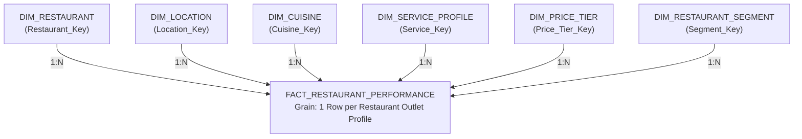
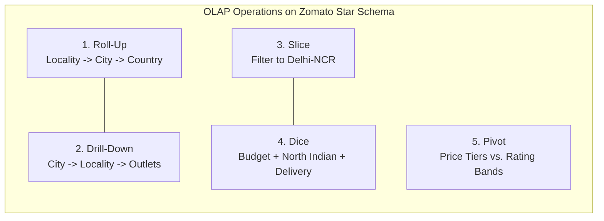

# ZOMATO RESTAURANT DISCOVERY & RELEVANCE ANALYTICS
## Enterprise Dimensional Model (Star Schema) Specification
**Course / Evaluation:** CIA IIIB — Data Warehousing, ETL & Business Intelligence  
**Artifact Companion:** [`Zomato_Star_Schema.png`](file:///c:/Projects/Zomotao/Zomato_Star_Schema.png)  

---

## 1. Architectural Overview & Kimball Modeling Principles

To transform Zomato’s raw operational listing data into an enterprise-grade analytical data warehouse, we employ the **Ralph Kimball Dimensional Modeling Methodology**. 

Unlike a normalized 3NF transactional database (OLTP) which is optimized for write operations and individual order inserts, this **Star Schema (OLAP)** is optimized for high-speed multi-dimensional analytical queries, aggregation slicing, and seamless Tableau integration without expensive runtime joins.



---

## 2. Fact Table Specification

### `FACT_RESTAURANT_PERFORMANCE`
* **Grain:** Exactly **one record per physical restaurant outlet listing** per analytical snapshot.
* **Table Type:** Accumulating Snapshot / Periodic Snapshot Fact Table.
* **Storage Optimization:** Columnar indexing on surrogate foreign keys; numeric measures stored as compressed decimals and integers.

| Column Name | SQL Data Type | Key Type | Description / Additive Nature |
| :--- | :--- | :---: | :--- |
| `Fact_Listing_Key` | `BIGINT` | **PK** | Surrogate identity primary key for the fact record. |
| `Restaurant_Key` | `INT` | **FK** | Surrogate key linking to `DIM_RESTAURANT`. |
| `Location_Key` | `INT` | **FK** | Surrogate key linking to `DIM_LOCATION`. |
| `Cuisine_Key` | `INT` | **FK** | Surrogate key linking to `DIM_CUISINE`. |
| `Service_Key` | `INT` | **FK** | Surrogate key linking to `DIM_SERVICE_PROFILE`. |
| `Price_Tier_Key` | `INT` | **FK** | Surrogate key linking to `DIM_PRICE_TIER`. |
| `Segment_Key` | `INT` | **FK** | Surrogate key linking to `DIM_RESTAURANT_SEGMENT`. |
| `Aggregate_Rating` | `DECIMAL(2,1)` | *Measure* | **Semi-Additive:** Average consumer rating ($0.0 - 5.0$). |
| `Votes` | `INT` | *Measure* | **Fully Additive:** Cumulative count of user reviews. |
| `Log_Votes` | `FLOAT` | *Measure* | **Non-Additive:** $\ln(1 + \text{Votes})$ scaled social proof index. |
| `Average_Cost_Clean` | `DECIMAL(10,2)` | *Measure* | **Semi-Additive:** Cleaned estimated meal cost for two in local currency. |
| `Normalized_Rating_Score`| `FLOAT` | *Measure* | **Non-Additive:** Rating mapped to continuous $0 - 100$ scale. |
| `Normalized_Engagement_Score`| `FLOAT` | *Measure* | **Non-Additive:** Log-votes mapped to continuous $0 - 100$ scale. |
| `Budget_Fit_Score` | `FLOAT` | *Measure* | **Non-Additive:** Piecewise linear affordability score ($0 - 100$). |
| `Relevance_Score` | `FLOAT` | *Measure* | **Non-Additive:** Weighted composite multi-attribute discovery score. |
| `Is_Rated_Flag` | `TINYINT` | *Measure* | **Fully Additive:** $1$ if rated, $0$ if unrated (cold-start). |
| `Listing_Count` | `INT` | *Measure* | **Fully Additive:** Constant $1$; simplifies `SUM(Listing_Count)` OLAP rollups. |

---

## 3. Dimension Tables Specification

### 1. `DIM_RESTAURANT`
* **Purpose:** Stores core entity metadata for restaurant businesses and chains.
* **SCD Strategy:** Slowly Changing Dimension (SCD Type 1 for address corrections; SCD Type 2 for re-branding).

| Column Name | Data Type | Key Type | Description |
| :--- | :--- | :---: | :--- |
| `Restaurant_Key` | `INT` | **PK** | Integer surrogate key. |
| `Restaurant_ID` | `BIGINT` | *Natural Key* | Operational business key from Zomato OLTP database. |
| `Restaurant_Name` | `VARCHAR(150)` | *Attribute* | Trade brand name of the venue. |
| `Address` | `VARCHAR(255)` | *Attribute* | Granular physical street address. |
| `Is_Chain_Brand` | `BOOLEAN` | *Attribute* | `TRUE` if brand has multiple outlets across the city. |
| `Outlet_Count_In_City` | `INT` | *Attribute* | Number of active city branches (e.g., CCD = 83, Subway = 63). |

---

### 2. `DIM_LOCATION`
* **Purpose:** Defines the spatial hierarchy supporting national, regional, and neighborhood drill-downs.
* **Dimensional Hierarchy:** `Country_Name` $\rightarrow$ `City` $\rightarrow$ `Locality`.

| Column Name | Data Type | Key Type | Description |
| :--- | :--- | :---: | :--- |
| `Location_Key` | `INT` | **PK** | Integer surrogate key. |
| `Locality` | `VARCHAR(100)` | *Attribute* | Specific dining neighborhood (e.g., *Connaught Place, GK-1*). |
| `Locality_Verbose` | `VARCHAR(150)` | *Attribute* | Descriptive combined locality and municipal descriptor. |
| `City` | `VARCHAR(80)` | *Attribute* | Metro market (e.g., *New Delhi, Gurgaon, Noida*). |
| `Country_Code` | `INT` | *Attribute* | ISO numeric country code (e.g., 1 for India). |
| `Country_Name` | `VARCHAR(60)` | *Attribute* | Full country name resolved from lookup table. |
| `Latitude` | `FLOAT` | *Attribute* | Verified spatial latitude coordinate. |
| `Longitude` | `FLOAT` | *Attribute* | Verified spatial longitude coordinate. |
| `Has_Valid_Coordinates` | `BOOLEAN` | *Attribute* | Data quality flag: `FALSE` for $(0.0, 0.0)$ Null Island entries. |

---

### 3. `DIM_CUISINE`
* **Purpose:** Encapsulates culinary offerings and gastronomic categories.

| Column Name | Data Type | Key Type | Description |
| :--- | :--- | :---: | :--- |
| `Cuisine_Key` | `INT` | **PK** | Integer surrogate key. |
| `Primary_Cuisine` | `VARCHAR(80)` | *Attribute* | Dominant culinary specialty (e.g., *North Indian, Mughlai*). |
| `Cuisine_Category` | `VARCHAR(50)` | *Attribute* | High-level grouping (e.g., *Regional Indian, Asian, Cafe, Fast Food*). |
| `Cuisine_Count` | `INT` | *Attribute* | Number of distinct cuisines tagged on menu. |
| `Full_Cuisine_List` | `VARCHAR(255)` | *Attribute* | Complete comma-separated list of offered cuisines. |
| `Is_Multi_Cuisine` | `BOOLEAN` | *Attribute* | Flag indicating multi-specialty kitchen. |

---

### 4. `DIM_SERVICE_PROFILE`
* **Purpose:** Categorizes operational fulfillment channels and digital integration.

| Column Name | Data Type | Key Type | Description |
| :--- | :--- | :---: | :--- |
| `Service_Key` | `INT` | **PK** | Integer surrogate key. |
| `Has_Online_Delivery` | `VARCHAR(5)` | *Attribute* | Binary delivery readiness (`'Yes'` / `'No'`). |
| `Has_Table_Booking` | `VARCHAR(5)` | *Attribute* | Advance dine-in reservation availability (`'Yes'` / `'No'`). |
| `Is_Delivering_Now` | `VARCHAR(5)` | *Attribute* | Real-time active kitchen dispatch status. |
| `Service_Profile_Name` | `VARCHAR(50)` | *Attribute* | *Both, Online Delivery Only, Table Booking Only, Dine-in Only*. |
| `Service_Readiness_Score`| `FLOAT` | *Attribute* | Operational baseline score ($20 - 100$ pts). |

---

### 5. `DIM_PRICE_TIER`
* **Purpose:** Standardizes economic affordability bands across varied menu price points.

| Column Name | Data Type | Key Type | Description |
| :--- | :--- | :---: | :--- |
| `Price_Tier_Key` | `INT` | **PK** | Integer surrogate key. |
| `Price_Range` | `INT` | *Attribute* | Ordinal classification tier ($1, 2, 3, 4$). |
| `Price_Tier_Name` | `VARCHAR(50)` | *Attribute* | *Budget (Tier 1), Moderate (Tier 2), Upscale (Tier 3), Fine Dining (Tier 4)*. |
| `Currency_Code` | `VARCHAR(10)` | *Attribute* | Local ISO currency identifier (e.g., `INR`, `USD`). |
| `Budget_Classification` | `VARCHAR(30)` | *Attribute* | High-level consumer segment (*Pocket-Friendly, Mid-Market, Luxury*). |
| `Benchmark_Avg_Cost` | `DECIMAL(10,2)`| *Attribute* | Market average benchmark cost for two within tier. |

---

### 6. `DIM_RESTAURANT_SEGMENT`
* **Purpose:** Aligns operational metrics with strategic business categories (Lab 7.2 LOD logic).

| Column Name | Data Type | Key Type | Description |
| :--- | :--- | :---: | :--- |
| `Segment_Key` | `INT` | **PK** | Integer surrogate key. |
| `Restaurant_Segment` | `VARCHAR(50)` | *Attribute* | *Market Leader, Hidden Gem, Popular Volume Driver, Average Performer, Underperforming, Unrated*. |
| `Rating_Status` | `VARCHAR(20)` | *Attribute* | Status indicator: `'Rated'` vs `'Unrated / New Entrant'`. |
| `Rating_Text` | `VARCHAR(30)` | *Attribute* | Zomato categorical status (*Excellent, Very Good, Good, Average, Poor*). |
| `Rating_Color_Code` | `VARCHAR(30)` | *Attribute* | Visual palette hex/name (*Dark Green, Green, Yellow, Orange, White*). |
| `Strategic_Action` | `VARCHAR(80)` | *Attribute* | Business intervention (*Protect & Monetize, Discovery Boost, Quality Audit, Incubation*). |

---

## 4. OLAP Multi-Dimensional Analytical Capabilities

This Star Schema provides native hardware acceleration for the 5 fundamental OLAP operations:



1. **Roll-Up (Aggregation):** Summarizing granular outlet performance up through geographic levels:
   $$\text{Outlet Level} \xrightarrow{\text{Roll-Up}} \text{Locality Level (GK-1)} \xrightarrow{\text{Roll-Up}} \text{City Level (New Delhi)} \xrightarrow{\text{Roll-Up}} \text{National Market (India)}$$
2. **Drill-Down (De-aggregation):** Navigating from high-level corporate BAN cards into granular locality clusters to pinpoint where "Hidden Gems" reside.
3. **Slice (1D Subsetting):** Isolating a single dimension slice, such as filtering the entire warehouse exclusively to the **Delhi-NCR Market ($N = 7,947$)**.
4. **Dice (Multi-Dimensional Subcube):** Intersecting multiple dimensions simultaneously:
   $$\text{Dice: } [\text{Locality} = \text{'Rajouri Garden'}] \times [\text{Price\_Tier} = \text{'Moderate'}] \times [\text{Has\_Online\_Delivery} = \text{'Yes'}]$$
5. **Pivot (Cross-Tabulation):** Rotating dimensions to form comparative matrices, such as plotting `Price_Tier` across Columns and `Rating_Text` down Rows to inspect merchant distributions (as implemented in Tableau Worksheet 7).

---

## 5. SQL DDL Implementation Scripts (PostgreSQL / Snowflake Compatible)

```sql
-- ====================================================================
-- DDL SCRIPT: ZOMATO ENTERPRISE DATA WAREHOUSE STAR SCHEMA
-- ====================================================================

-- 1. Create Dimension: DIM_RESTAURANT
CREATE TABLE DIM_RESTAURANT (
    Restaurant_Key          SERIAL PRIMARY KEY,
    Restaurant_ID           BIGINT NOT NULL UNIQUE,
    Restaurant_Name         VARCHAR(150) NOT NULL,
    Address                 VARCHAR(255),
    Is_Chain_Brand          BOOLEAN DEFAULT FALSE,
    Outlet_Count_In_City    INT DEFAULT 1
);

-- 2. Create Dimension: DIM_LOCATION
CREATE TABLE DIM_LOCATION (
    Location_Key            SERIAL PRIMARY KEY,
    Locality                VARCHAR(100) NOT NULL,
    Locality_Verbose        VARCHAR(150),
    City                    VARCHAR(80) NOT NULL,
    Country_Code            INT NOT NULL,
    Country_Name            VARCHAR(60) NOT NULL,
    Latitude                FLOAT,
    Longitude               FLOAT,
    Has_Valid_Coordinates   BOOLEAN DEFAULT TRUE
);

-- 3. Create Dimension: DIM_CUISINE
CREATE TABLE DIM_CUISINE (
    Cuisine_Key             SERIAL PRIMARY KEY,
    Primary_Cuisine         VARCHAR(80) NOT NULL,
    Cuisine_Category        VARCHAR(50),
    Cuisine_Count           INT DEFAULT 1,
    Full_Cuisine_List       VARCHAR(255),
    Is_Multi_Cuisine        BOOLEAN DEFAULT FALSE
);

-- 4. Create Dimension: DIM_SERVICE_PROFILE
CREATE TABLE DIM_SERVICE_PROFILE (
    Service_Key             SERIAL PRIMARY KEY,
    Has_Online_Delivery     VARCHAR(5) NOT NULL,
    Has_Table_Booking       VARCHAR(5) NOT NULL,
    Is_Delivering_Now       VARCHAR(5) DEFAULT 'No',
    Service_Profile_Name    VARCHAR(50) NOT NULL,
    Service_Readiness_Score FLOAT DEFAULT 20.0
);

-- 5. Create Dimension: DIM_PRICE_TIER
CREATE TABLE DIM_PRICE_TIER (
    Price_Tier_Key          SERIAL PRIMARY KEY,
    Price_Range             INT NOT NULL CHECK (Price_Range BETWEEN 1 AND 4),
    Price_Tier_Name         VARCHAR(50) NOT NULL,
    Currency_Code           VARCHAR(10) NOT NULL,
    Budget_Classification   VARCHAR(30),
    Benchmark_Avg_Cost      DECIMAL(10,2)
);

-- 6. Create Dimension: DIM_RESTAURANT_SEGMENT
CREATE TABLE DIM_RESTAURANT_SEGMENT (
    Segment_Key             SERIAL PRIMARY KEY,
    Restaurant_Segment      VARCHAR(50) NOT NULL,
    Rating_Status           VARCHAR(20) NOT NULL,
    Rating_Text             VARCHAR(30),
    Rating_Color_Code       VARCHAR(30),
    Strategic_Action        VARCHAR(80)
);

-- 7. Create Central Fact Table: FACT_RESTAURANT_PERFORMANCE
CREATE TABLE FACT_RESTAURANT_PERFORMANCE (
    Fact_Listing_Key            BIGSERIAL PRIMARY KEY,
    Restaurant_Key              INT NOT NULL REFERENCES DIM_RESTAURANT(Restaurant_Key),
    Location_Key                INT NOT NULL REFERENCES DIM_LOCATION(Location_Key),
    Cuisine_Key                 INT NOT NULL REFERENCES DIM_CUISINE(Cuisine_Key),
    Service_Key                 INT NOT NULL REFERENCES DIM_SERVICE_PROFILE(Service_Key),
    Price_Tier_Key              INT NOT NULL REFERENCES DIM_PRICE_TIER(Price_Tier_Key),
    Segment_Key                 INT NOT NULL REFERENCES DIM_RESTAURANT_SEGMENT(Segment_Key),
    
    -- Additive & Semi-Additive Numerical Facts
    Aggregate_Rating            DECIMAL(2,1) NOT NULL,
    Votes                       INT NOT NULL DEFAULT 0,
    Log_Votes                   FLOAT NOT NULL DEFAULT 0.0,
    Average_Cost_Clean          DECIMAL(10,2) NOT NULL,
    Normalized_Rating_Score     FLOAT NOT NULL DEFAULT 0.0,
    Normalized_Engagement_Score FLOAT NOT NULL DEFAULT 0.0,
    Budget_Fit_Score            FLOAT NOT NULL DEFAULT 100.0,
    Relevance_Score             FLOAT NOT NULL DEFAULT 0.0,
    Is_Rated_Flag               TINYINT NOT NULL DEFAULT 1,
    Listing_Count               INT NOT NULL DEFAULT 1
);

-- Performance Indexing for High-Speed Tableau Live Connections
CREATE INDEX idx_fact_location ON FACT_RESTAURANT_PERFORMANCE(Location_Key);
CREATE INDEX idx_fact_cuisine ON FACT_RESTAURANT_PERFORMANCE(Cuisine_Key);
CREATE INDEX idx_fact_service ON FACT_RESTAURANT_PERFORMANCE(Service_Key);
CREATE INDEX idx_fact_segment ON FACT_RESTAURANT_PERFORMANCE(Segment_Key);
CREATE INDEX idx_fact_price ON FACT_RESTAURANT_PERFORMANCE(Price_Tier_Key);
```

---
*Diagram Graphic Reference:* [`Zomato_Star_Schema.png`](file:///c:/Projects/Zomotao/Zomato_Star_Schema.png)  
*Verified Dataset Source:* [`data/processed/zomato_ncr_clean.csv`](file:///c:/Projects/Zomotao/data/processed/zomato_ncr_clean.csv)

